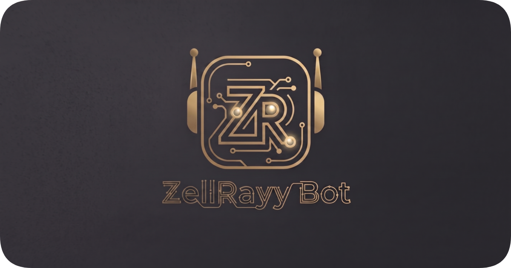

<div align="center">



# 🤖 ZellRayy-Bot

**WhatsApp Multi-Device Automation Bot**
*Powered by Node.js, Baileys ES Modules, and ZellRayy API*

[](https://nodejs.org/)
[](https://github.com/WhiskeySockets/Baileys)
[](https://api.zellrayy.com)
[](https://github.com/Bhuzel)
[](LICENSE)

</div>

---

## 📌 Deskripsi Ringkas

**ZellRayy-Bot** adalah bot WhatsApp modern dan bertenaga tinggi berbasis **Node.js (ES Modules)** dan library `@whiskeysockets/baileys`. Dirancang dengan **Arsitektur 1-Plugin-Per-Berkas**, sistem **Hot-Reload Plugin**, antarmuka **Interactive Native Flow Buttons (Image Header + URL CTA + List Selection Dropdown)**, serta integrasi resmi layanan [ZellRayy API](https://api.zellrayy.com).

Bot ini mendukung fitur lengkap untuk pengelolaan grup, pengunduhan media, pembuatan stiker, pencarian data/lirik, manajemen status WhatsApp, hingga sistem kontrol owner yang aman.

---

## ✨ Fitur & Keunggulan Utama

- 🎨 **Interactive Native Flow Buttons Suite (`.bmenu` & `.ballmenu`)**:
  - Tampilan menu interaktif modern dilengkapi **Image Banner Header**, tombol **URL CTA (Kunjungi Web)**, dan **List Dropdown Selection** interaktif yang dikelompokkan per kategori.
  - Bebas dari tampilan emoji berlebihan, menghasilkan UI yang clean, cepat, dan responsif di seluruh tipe aplikasi WhatsApp (Android, iOS, Web, Desktop).
- ⚡ **Dynamic Prefix & Flexible Mode Engine**:
  - Konfigurasi `usePrefix: false` mendukung penggunaan perintah **dengan prefix** (misal `.ping`) maupun **tanpa prefix** (misal `ping`).
  - Ketika `usePrefix: true`, bot secara ketat hanya merespon perintah ber-prefix.
- 🔒 **Self & Public Mode Switcher (`.mode` / `.public` / `.self`)**:
  - Pengalihan mode pengoperasian bot secara instan tanpa perlu merestart bot. Didukung oleh *whitelist user* pada `database/access-self.json`.
- 🚫 **Ban Chat Group Manager (`.banchat` / `.unbanchat`)**:
  - Memungkinkan owner memblokir bot di grup tertentu agar bot tidak merespon anggota grup tersebut, tanpa mengganggu akses owner di dalam grup. Tersimpan permanen di `database/bannedChats.json`.
- 🛡️ **Realtime Group Admin Fallback Engine**:
  - Penanganan status admin bot secara cerdas dan realtime. Jika bot baru saja dijadikan admin di WhatsApp, bot akan melakukan *auto force-fetch* metadata terbaru dari server WhatsApp tanpa perlu restart.
- 📢 **WhatsApp Channel Integration (`.postch` & `.cekidch`)**:
  - Fitur kirim pesan/media langsung ke WhatsApp Channel (`.postch`) serta inspeksi metadata lengkap saluran (`.cekidch`).
- 👥 **Group Inspector & Profile Picture Manager (`.cekidgc`, `.setppgc`, `.delppgc`)**:
  - Inspeksi detail ID grup (`.cekidgc`) langsung di grup atau via link undangan WhatsApp.
  - Pengubahan dan penghapusan foto profil grup (`.setppgc` & `.delppgc`) khusus admin.
- 🎵 **ZellRayy API Integration**:
  - Integrasi pencarian lirik lagu (`.lirik`), converter media (Audio to MP3, Video to VN, WebP to Image/Video), dan berbagai utilitas canggih.

---

## 📂 Struktur Repositori

```text
Percobaan/
├── config.js               # Pengaturan utama identitas, prefix, owner, & pesan bot
├── index.js                # Main entrypoint, socket listener, & middleware handler
├── package.json            # Manifest proyek & dependensi npm
├── database/               # Penyimpan data lokal & aset gambar
│   ├── image.png           # Banner gambar utama menu / bot header
│   ├── access-self.json    # Data status & whitelist Self Mode
│   ├── ...                 # Data list lainnya
├── lib/                    # Core library & helper utilities
│   ├── serialize.js        # Formatter & serializer pesan Baileys
│   ├── button.js           # Engine pembuat Interactive Native Flow Buttons
│   ├── wrapper.js          # Socket method extensions
│   ├── pluginLoader.js     # Loader & watcher plugin otomatis
│   ├── helper.js           # Helper ekstraksi URL & teks
│   ├── bannedChatDB.js     # Database handler chat/grup terban
│   └── ...                 # DB handler owner, premium, banned, converter, dll
└── plugins/                # Direktori plugin perintah bot
    ├── main/               # Plugin menu utama (.menu, .bmenu, .ballmenu)
    ├── group/              # Plugin pengelola grup (.setppgc, .linkgc, .kick, dll)
    ├── owner/              # Plugin khusus owner (.mode, .banchat, .sw, .postch, dll)
    ├── downloader/         # Plugin pengunduh media (.ytmp3, .ytmp4, .tiktok, dll)
    ├── search/             # Plugin pencarian data (.lirik, .lirikspotify)
    ├── maker/              # Plugin pembuat stiker (.sticker, .wm, .brat, dll)
    ├── tools/              # Plugin utilitas (.cekid, .cekidgc, .cekidch, .tomp3, dll)
    └── info/               # Plugin informasi bot (.ping, .info, .owner, dll)
```

---

## ⚙️ Panduan Konfigurasi (`config.js`)

Seluruh pengaturan utama bot dikelola di file **[`config.js`](file:///d:/Rayhan/Coding/A-Program%20Bot%20Juli%202026/Percobaan/config.js)**:

```javascript
export default {
  // Identitas Bot
  botName: 'ZellRayy-Bot',
  sessionName: 'session',

  // Mode Login ( Pairing Code / QR Code )
  pairingMode: true,

  // Pengaturan Prefix
  prefix: ['.', '/', '!', '#'],
  usePrefix: false, // false = fleksibel (bisa pake prefix & tanpa prefix), true = wajib prefix

  // Daftar Nomor Owner (Gunakan format 628xxx tanpa simbol + atau -)
  ownerNumber: [
    '6282352052566'
  ],
  premiumNumber: [],

  // Tampilan Menu Utama (.menu)
  menuStyle: 'interactive', // 'interactive' (link card preview), 'image', atau 'text'
  menuThumbnail: 'https://api.zellrayy.com/assets/logo.png', // URL gambar thumbnail
  menuLink: 'https://api.zellrayy.com',

  // API Key & Metadata Stiker
  apiKeys: {
    zellrayy: 'ISI_API_KEY_KAMU_DISINI'
  },
  sname: 'ZellRayy-Bot',
  sauthor: 'BhuzelRayhan',

  // Pesan Response Default
  messages: {
    wait: 'Sedang memproses, mohon tunggu...',
    owner: 'Fitur ini khusus untuk owner bot.',
    premium: 'Fitur ini khusus untuk member premium.',
    group: 'Fitur ini hanya dapat digunakan dalam grup.',
    private: 'Fitur ini hanya dapat digunakan di chat pribadi.',
    botAdmin: 'Hanya admin grup yang dapat menggunakan fitur ini.',
    grootbotbup: 'Bot belum menjadi admin dalam grup ini.'
  }
}
```

---

## 🔒 Panduan Pengaturan Mode Bot (Public vs Self Mode)

Bot memiliki 2 opsi mode akses:

1. **Public Mode (Default)**:
   - Seluruh pengguna WhatsApp dapat menggunakan perintah bot yang bertipe publik.
2. **Self Mode (Mode Pribadi)**:
   - Bot hanya akan merespon pesan dari **Owner** dan pengguna yang terdaftar di **whitelist**.

### Cara Mengubah Mode:
- **Melalui WhatsApp (Perintah Owner)**:
  - `.mode` ➡️ Mengecek status mode bot saat ini.
  - `.public` ➡️ Mengubah bot menjadi Mode Public.
  - `.self` ➡️ Mengubah bot menjadi Mode Self.
- **Melalui Berkas database**:
  - Buka file `database/access-self.json`:
    ```json
    {
      "active": false,
      "whitelist": []
    }
    ```
    - Set `"active": true` sejak awal untuk mengaktifkan default Self Mode.
    - Tambahkan nomor pengguna ke array `"whitelist"` jika ingin memberi akses khusus saat Self Mode.

---

## 🚀 Panduan Instalasi & Menjalankan Bot

### 1. Persyaratan Sistem
- **Node.js**: Versi 18.0.0 atau yang lebih baru.
- **FFmpeg**: Terinstall pada OS (untuk kebutuhan fitur konversi media & stiker animasi).

### 2. Langkah Instalasi
```bash
# 1. Clone repositori ini ke komputer / server kamu
git clone https://github.com/Bhuzel/ZellRayy-Bot.git
cd ZellRayy-Bot

# 2. Install seluruh dependensi npm
npm install

# 3. Jalankan bot
npm start
```

### 3. Tautan Akun via Kode Pairing (8-Digit Pairing Code)
1. Pastikan `pairingMode: true` pada `config.js`.
2. Saat perintah `npm start` dijalankan di terminal, bot akan meminta nomor telepon WhatsApp kamu (contoh: `6282352052566`).
3. Masukkan nomor telepon lalu tekan **Enter**.
4. Salin **Kode Pairing 8 Digit** (misal: `ZELL-1234`) yang muncul di terminal.
5. Buka aplikasi WhatsApp di Smartphone ➡️ **Perangkat Tertaut (Linked Devices)** ➡️ **Tautkan dengan Nomor Telepon**, lalu masukkan kode tersebut.
6. Setelah sukses terhubung, kredensial sesi akan otomatis tersimpan di folder `session/`.

---

## 🧩 Panduan Menambah Fitur Baru (Plugin Manager)

**ZellRayy-Bot** menggunakan arsitektur **1-Plugin-Per-Berkas (ES Modules)** dengan fitur **Hot-Reload**. Kamu tidak perlu mendaftarkan plugin secara manual di `index.js` — cukup buat berkas `.js` baru di dalam direktori `plugins/<kategori>/`, dan bot akan otomatis mendeteksi serta memuatnya tanpa perlu merestart server.

### 🛠️ Struktur Dasar Berkas Plugin

Buat berkas JavaScript baru di `plugins/<kategori>/<nama_plugin>.js`:

```javascript
export default {
  name: 'Nama Fitur Kamu',            // Nama fitur yang tampil di menu dropdown (.bmenu / .ballmenu)
  command: ['perintah', 'alias1'],    // Perintah panggilan bot (array string)
  category: 'tools',                  // Kategori menu (main, group, owner, downloader, search, maker, tools, ai, info)
  description: 'Deskripsi singkat',   // Penjelasan kegunaan fitur
  settings: {                         // Pengaturan hak akses (opsional)
    owner: false,                     // true = khusus owner bot
    premium: false,                   // true = khusus member premium
    group: false,                     // true = khusus di dalam grup
    private: false,                   // true = khusus di private chat
    admin: false,                     // true = khusus admin grup
    botAdmin: false                   // true = bot wajib jadi admin grup
  },

  async run({ m, args, text, react, sock, config, usedPrefix }) {
    // 1. Berikan respon emotil loading (opsional)
    await react('loading')

    // 2. Logika fitur / panggil API kamu
    if (!args[0]) {
      await react('error')
      return m.reply('Masukkan parameter yang dibutuhkan!')
    }

    // 3. Kirim respon balasan
    await m.reply(`Halo! Kamu mengetik: ${args.join(' ')}`)
    await react('ok')
  }
}
```

### 💡 Variabel Parameter Pada Handler `run`:

| Parameter | Tipe | Deskripsi |
| :--- | :--- | :--- |
| `m` | `Object` | Object pesan Baileys ter-serialize (memiliki method `m.reply()`, `m.download()`, `m.react()`, `m.chat`, `m.sender`, dll) |
| `args` | `Array` | Parameter argumen teks yang dipisah spasi (contoh: `['halo', 'dunia']`) |
| `text` | `String` | Gabungan teks argumen (contoh: `'halo dunia'`) |
| `react` | `Function` | Helper reaksi emoji pada pesan (`await react('loading')`, `'ok'`, atau `'error'`) |
| `sock` | `Object` | Instance WASocket Baileys utama |
| `config` | `Object` | Konfigurasi bot dari `config.js` |
| `usedPrefix` | `String` | Prefix yang digunakan saat memanggil perintah |

### 🛠️ Daftar Helper Method Pengiriman Pesan & Media (`m` & `sock`)

Di dalam handler plugin `run({ m, sock })`, kamu dapat menggunakan helper method berikut secara langsung untuk mengirim teks, media, stiker, kontak, dan tombol:

#### 1. Method Utama pada Object `m` (Merespon Chat Saat Ini)

| Method | Contoh Penggunaan | Deskripsi |
| :--- | :--- | :--- |
| `m.reply(text)` | `await m.reply('Halo dunia!')` | Membalas pesan dengan me-quote pesan pengirim |
| `m.sendText(text)` | `await m.sendText('Pesan tanpa quote')` | Mengirim pesan teks tanpa me-quote pesan pengirim |
| `m.sendImage(bufOrUrl, caption)` | `await m.sendImage(buffer, 'Ini gambar')` | Mengirim gambar (dari Buffer atau URL link) |
| `m.sendVideo(bufOrUrl, caption)` | `await m.sendVideo(buffer, 'Ini video')` | Mengirim video MP4 (dari Buffer atau URL link) |
| `m.sendAudio(bufOrUrl, ptt)` | `await m.sendAudio(buffer, true)` | Mengirim audio MP3 atau Voice Note PTT (jika `ptt: true`) |
| `m.sendSticker(buffer, opts)` | `await m.sendSticker(buffer, { packname, author })` | Mengirim stiker WebP (statis atau animasi) |
| `m.sendDocument(buffer, fileName, opts)` | `await m.sendDocument(buffer, 'data.pdf')` | Mengirim berkas / dokumen |
| `m.sendContact(number, name)` | `await m.sendContact('6282352052566', 'ZellRayy')` | Mengirim kartu kontak vCard |
| `m.sendLocation(lat, lng, name)` | `await m.sendLocation(-6.2, 106.8, 'Jakarta')` | Mengirim lokasi peta |
| `m.sendButton(caption, buttons, footer)` | `await m.sendButton('Pilih:', [{ text: 'Ping', id: '.ping' }])` | Mengirim tombol interaktif (Native Flow) |
| `m.react(emoji)` | `await react('loading')` / `'ok'` / `'error'` | Memberikan reaksi emoji pada pesan pengirim |
| `m.download(fromQuoted)` | `const buf = await m.download(true)` | Mengunduh media (foto/video/vn/stiker) dari pesan atau quoted reply |
| `m.delete()` | `await m.delete()` | Menghapus pesan (jika bot admin atau pesan dari me) |

#### 2. Method Utama pada Object `sock` (Socket Instance Baileys)

| Method | Contoh Penggunaan | Deskripsi |
| :--- | :--- | :--- |
| `sock.sendMessage(jid, content, opts)` | `await sock.sendMessage(m.chat, { text: 'Halo', ai: true })` | Method standar Baileys (mendukung `{ ai: true }` untuk AI badge) |
| `sock.sendButtons(jid, data, opts)` | `await sock.sendButtons(m.chat, { image, caption, buttons })` | Mengirim Interactive Native Flow Buttons (Image Header + CTA + List) |
| `sock.groupMetadata(jid)` | `const meta = await sock.groupMetadata(m.chat)` | Mengambil metadata grup (nama, member, admin, dll) |
| `sock.newsletterMetadata(type, key)` | `const meta = await sock.newsletterMetadata('invite', code)` | Mengambil metadata WhatsApp Channel / Newsletter |
| `sock.updateProfilePicture(jid, buf)` | `await sock.updateProfilePicture(m.chat, buffer)` | Memperbarui foto profil akun bot atau grup |
| `sock.removeProfilePicture(jid)` | `await sock.removeProfilePicture(m.chat)` | Menghapus foto profil akun bot atau grup |

---

## 🌐 Tautan & Kontak Resmi

- **Developer GitHub**: [https://github.com/Bhuzel](https://github.com/Bhuzel)
- **Repositori Proyek**: [https://github.com/Bhuzel/ZellRayy-Bot](https://github.com/Bhuzel/ZellRayy-Bot)
- **Layanan API**: [https://api.zellrayy.com](https://api.zellrayy.com)

---

<div align="center">

Distributed under the **MIT License**. Created and maintained with ❤️ by **[ZellRayy (Bhuzel)](https://github.com/Bhuzel)**.

</div>
